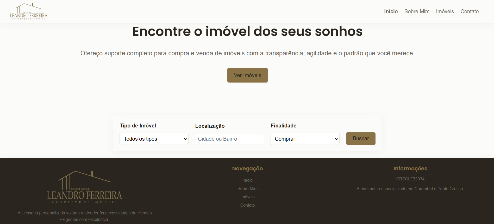

# 🏢 Site Imobiliário - Atividade de Front-End | Unicesumar

Seja bem-vindo ao repositório do meu projeto de Front-End! Este site foi desenvolvido como parte de uma atividade acadêmica para a Unicesumar. 

Unindo minhas duas áreas de atuação, decidi criar uma plataforma voltada para o mercado imobiliário, aplicando conceitos práticos de design, usabilidade e arquitetura de software para resolver um problema real do meu dia a dia profissional.

---

## 🎯 O Objetivo do Projeto
A ideia principal é construir uma aplicação web funcional, intuitiva e responsiva para a busca e visualização de imóveis. O usuário poderá navegar por diferentes seções e simular a busca pelo seu próximo imóvel.

### 📑 Páginas Planejadas:
*   **Página Principal (Home):** Onde o usuário inicia a jornada. Contará com um sistema de busca com filtros personalizáveis (ex: tipo de imóvel, localização) e um botão de acesso rápido para a listagem completa.
*   **Imóveis:** Uma vitrine completa com os cards de cada propriedade disponível.
*   **Sobre:** Detalhes sobre a empresa e a proposta do negócio.
*   **Contato:** Um formulário para que os leads entrem em contato diretamente.

---

## 🛠️ Tecnologias Utilizadas
*   **HTML5:** Estruturação semântica das páginas.
*   **CSS3:** Estilização, layout (Flexbox/Grid) e responsividade.
*   **JavaScript:** Para a lógica dos filtros de busca.
*   **Desenvolvimento do front-end com HTML e CSS.** Utilização de IA generativa como assistente de código para apoio no refinamento de layout e geração de dados fictícios para os imóveis.
---

## 📁 Estrutura do Projeto
```
├── index.html             # Página principal (Home)
├── imoveis.html           # Página de listagem de imóveis
├── sobre.html             # Página institucional
├── contato.html           # Página de contato
├── css/                   # Pasta para os arquivos de estilo
│   └── style.css          # CSS principal
├── js/                    # Pasta para scripts
│   └── contactForm.js     # Formulário de contato
|   └── formFiltro.js      # Filtro de busca
└── assets/                # Pasta para imagens dos imóveis, logos, etc.
```

---

## 🚀 Como Executar o Projeto Localmente
1. **Clone este repositório:**
   ```bash
   git clone https://github.com/LeandroStepurski/site-imobiliario.git
   ```
   
2. Navegue até a pasta do projeto e abra o arquivo index.html diretamente no seu navegador, ou utilize a extensão Live Server no VS Code para visualizar as alterações em tempo real.

---

## ✒️ Desenvolvido por: 
  Leandro Stepurski Ferreira - *Estudante de Engenharia de Software & Corretor de Imóveis | CRECI PR F32.934*

